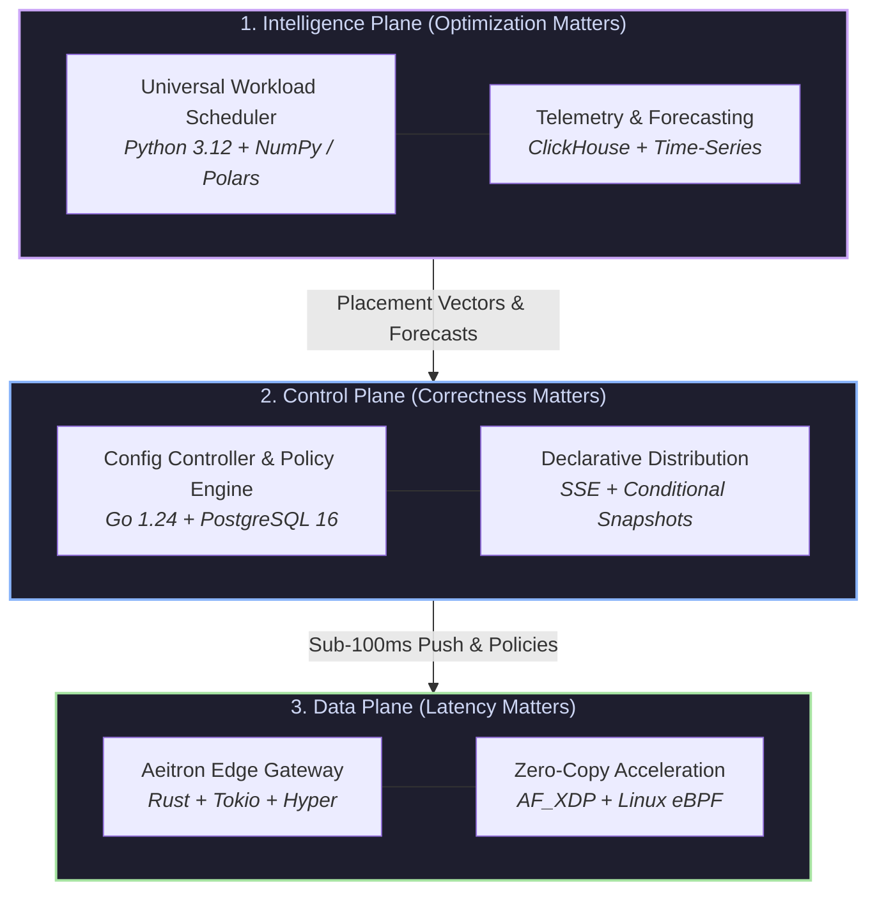

<div align="center">

# Aeitron

**The Intelligent Global Edge, Security & Workload Placement Platform**

[](https://github.com/aeitron)
[](https://github.com/aeitron)
[](https://github.com/aeitron)
[](https://github.com/aeitron/mcp-server)
[](LICENSE)

<p align="center">
  <a href="https://aeitron.com">Website</a> •
  <a href="https://docs.aeitron.com">Documentation</a> •
  <a href="https://console.aeitron.com">Console</a> •
  <a href="https://github.com/aeitron/mcp-server">MCP Server</a> •
  <a href="#-architecture">Architecture</a>
</p>

---

</div>

## 🌐 Overview

**Aeitron** is an intelligent, unified infrastructure platform engineered from first principles for modern cloud, edge, and Generative AI applications. 

By converging **line-rate L7 proxying**, **multi-objective intelligent workload scheduling**, and **fail-closed zero-trust edge security**, Aeitron eliminates the latency, cost, and complexity overhead of legacy content delivery and cloud routing networks.

> **Engineering Creed:**  
> `Correctness > Security > Reliability > Maintainability > Performance > Speed`

---

## 🏛️ Architecture: The 3-Plane Master Topology

Aeitron decouples operations into three purpose-built execution planes:



### 1. 🧠 Intelligence Plane *(Python 3.12+)*
- **Universal Workload Scheduler:** Dynamically scores placement decisions across **6 multi-objective vectors**: Network Latency, Spot Pricing, Carbon Intensity, KV-Cache Locality, Hardware Capacity, and Data Sovereignty.
- **Predictive Telemetry:** Real-time routing decisions backed by time-series telemetry and global transit telemetry.

### 2. 🎮 Control Plane *(Go 1.24 & TypeScript)*
- **Config Controller:** Sub-100ms declarative reconciliation loops managing domain onboarding, SSL/TLS certificates, routing policies, and WAF rulesets.
- **Edge State Synchronization:** High-reliability distribution via HTTP Server-Sent Events (SSE) and conditional snapshots, enabling edge gateways to serve autonomously during control plane partitions.
- **Commerce & Billing Engine:** Precision micro-metering and tenancy billing.

### 3. ⚡ Data Plane *(Rust 2021)*
- **High-Throughput Gateway (`aeitron-gateway`):** Tokio and Hyper-powered L7 proxy delivering sub-millisecond TTFB.
- **Zero-Copy Acceleration:** Native AF_XDP and Linux eBPF integration for wire-speed packet filtering and DDoS mitigation.
- **RFC 9111 Caching:** Standards-compliant tiered edge cache with cache-revalidation, stale-while-revalidate, and bypass protections.
- **MicroVM Runtime:** Lightweight compute isolation for edge serverless functions and isolated AI workloads.

---

## 🌍 Strategic Anycast Point of Presence (PoP) Mesh

Aeitron distributes edge compute and routing across strategic geopolitical hubs:

| PoP Code | Metro Region | Role & Strategic Interconnect |
| :--- | :--- | :--- |
| **`bd-dac`** | 🇧🇩 Dhaka | Primary sovereign gateway, multi-Tbps BDIX domestic peering, SMW6 submarine cable landing |
| **`sg-sin`** | 🇸🇬 Singapore | Southeast Asian transit hub & low-latency financial backbone cross-connect |
| **`de-fra`** | 🇩🇪 Frankfurt | Continental European internet exchange (DE-CIX) & green compute cluster |
| **`us-iad`** | 🇺🇸 North Virginia | North American high-density AI compute, Tier-1 transit backbone |
| **`is-kef`** | 🇮🇸 Iceland | 100% Geothermal & hydro-powered zero-carbon batch compute cluster |

---

## 🛡️ Security & Zero-Trust Invariants

- **Origin SSRF Defense:** Strict rejection of RFC 1918, loopback, link-local, and cloud metadata IPs, accompanied by deterministic DNS pinning.
- **Fail-Closed Design:** In the event of backend unavailability or configuration corruption, the edge fails closed to protect tenant boundaries and origin integrity.
- **Cryptographic Auditability:** Merkle audit chaining and HMAC signature verification for state changes and administrative operations.
- **Data Residency Compliance:** Strict geofencing and sovereignty policy enforcement compliant with EU GDPR and national regulatory frameworks.

---

## 🤖 Native Model Context Protocol (MCP) Integration

Aeitron provides native integration for AI agents and LLMs via the official [Model Context Protocol (MCP)](https://modelcontextprotocol.io):

```
AI Clients (Claude / ChatGPT / AGY)
               │ (Secure JSON-RPC 2.0 / SSE)
               ▼
   Aeitron MCP Server (OAuth 2.0 / Cryptographic Tokens / RBAC)
               │ (Authorized Infrastructure Calls)
               ▼
   Aeitron Cloud & Edge Infrastructure (API Gateway / DNS / Compute)
```

- **Cryptographic Token Verification:** HMAC-SHA256 signature checking, strict expiration, and audience/issuer assertions.
- **Granular RBAC Scopes:** Every infrastructure operation enforces explicit tool-level scopes (`account:read`, `projects:write`, `dns:write:delete`).
- **Safety Guards & Dry-Run:** Destructive operations (e.g. DNS deletion) require interactive dry-run previews and explicit user confirmation.

---

## 📦 Key Repositories & Ecosystem

* [**`aeitron/api`**](https://github.com/aeitron/api) — Core Edge & Infrastructure API, Domain Services, and Gateway.
* [**`aeitron/mcp-server`**](https://github.com/aeitron/mcp-server) — Official Model Context Protocol (MCP) Server for AI Assistants.
* [**`aeitron/dataplane`**](https://github.com/aeitron) — High-performance Rust edge gateway, AF_XDP network engine, and microVM runtime.
* [**`aeitron/client-sdks`**](https://github.com/aeitron) — Official developer SDKs for TypeScript, Python, and Go.

---

## 🤝 Community & Support

- 📖 **Documentation:** [docs.aeitron.com](https://docs.aeitron.com)
- 🖥️ **Console:** [console.aeitron.com](https://console.aeitron.com)
- 💬 **Discussions & Feedback:** [GitHub Discussions](https://github.com/orgs/aeitron/discussions)
- 🔒 **Security Advisories:** Please report security vulnerabilities to `security@aeitron.com`.

---

<div align="center">
  <sub>© 2026 Aeitron Infrastructure. All rights reserved. Built with precision for the global edge.</sub>
</div>
